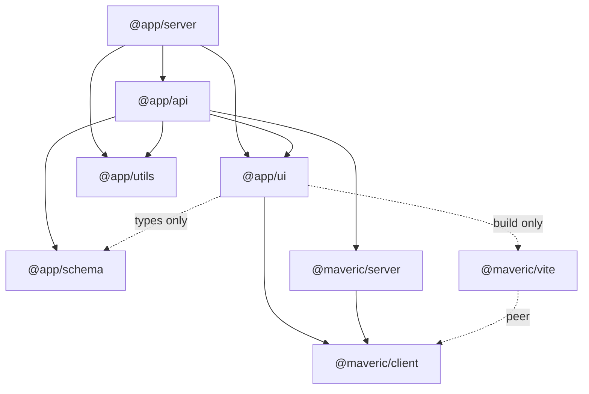
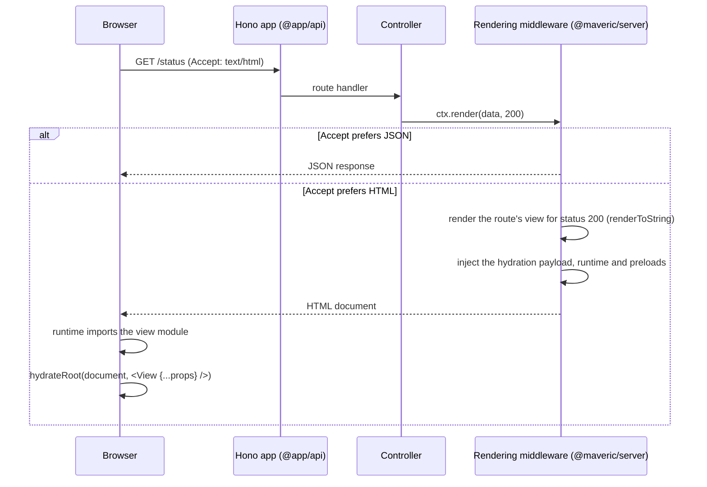

# Architecture

This document describes how the project is structured, how a request flows through it, and the principles behind the structure. Details of the individual mechanisms are covered by the other documents in this directory.

## Goals

- **API-first.** Every endpoint is a typed JSON API, described by an OpenAPI document. An HTML page is just another representation of the same response.
- **Server-rendered, hydrated UI.** Pages are rendered by React on the server and hydrated in the browser, so they work without JavaScript and become interactive once it loads.
- **End-to-end types.** Request and response shapes are defined once as [Zod](https://zod.dev) schemas and shared by the API, the OpenAPI document and the views.
- **Layered monorepo.** The application is split into packages by responsibility. During development, the whole project behaves as a single program; for production, every package is built on its own.

## Packages

| Package | Directory | Responsibility | Built by |
|---|---|---|---|
| `@maveric/client` | `libs/maveric-client` | Framework: `view()` helper, browser runtime, contracts shared by server and browser | `tsc` |
| `@maveric/server` | `libs/maveric-server` | Framework: `Controller`, `route()`, rendering middleware | `tsc` |
| `@maveric/vite` | `libs/maveric-vite` | Framework: Vite plugin (client manifest, HMR, client build) | `tsc` |
| `@app/schema` | `packages/schema` | Request and response schemas, shared by server and client | `tsc` |
| `@app/utils` | `packages/utils` | Server-side utilities, such as the configuration read from environment variables | `tsc` |
| `@app/ui` | `packages/ui` | Views and the `App` layout; browser bundle and server-side modules | Vite (+ `tsc` for declarations) |
| `@app/api` | `packages/api` | The Hono application: controllers, middleware, OpenAPI documentation | `tsc` |
| `@app/server` | `apps/server` | Node.js entry point; the deployable production bundle | Vite (+ `tsc` for type checking) |

The three top-level directories have distinct roles:

- **`libs/`** contains the [Maveric](../libs/maveric/README.md) framework. These packages don't know anything about this particular application and may later move to a standalone repository.
- **`packages/`** contains the layers of the application. They are libraries: they export code, but don't run on their own.
- **`apps/`** contains deployable entry points, one per deployment target. Currently, there's a single Node.js server; a target such as Cloudflare Workers would get its own app package, consuming the same `packages/`.

### Dependencies between packages

Every package declares all workspace packages it imports, and imports them only through their public entry points (`exports` in `package.json`). See [Workspace packages](workspace-packages.md).

## Request lifecycle

The same URL serves JSON or HTML, depending on the `Accept` header of the request. A controller always returns data; the rendering middleware decides how to represent it.

- The view receives the response data as its props. The props are rendered in their JSON form, exactly as the browser receives them for hydration.
- Views render the whole document, including `<html>`, through the `App` layout, so the browser hydrates the whole document.
- When `API_DOCS` is enabled, the OpenAPI document is served at `/docs.json`, with Swagger UI at `/docs`.

The mechanism is described in detail in [Server-side rendering and hydration](rendering.md).

## Development and production contexts

The project deliberately behaves differently during development and in production:

| | Development | Production |
|---|---|---|
| Workspace packages resolve to | their source files (`source` export condition) | their build outputs (`import` export condition) |
| TypeScript | one program: the root `tsconfig.json` | one program per package: `tsconfig.build.json` |
| Vite | one dev server for the whole project (root `vite.config.ts`) | per-package configs (`@app/ui`, `@app/server`) |
| Orchestration | `pnpm dev` | `pnpm build` (Turborepo, in dependency order) |

During development, a change in any package is immediately visible to all packages that depend on it, without rebuilding anything, and the dev server sees a single module graph, which makes hot reloading precise. In production, every package is built from its own sources and the build outputs of its dependencies, exactly as if the dependencies were installed from a registry.

What makes both contexts consistent is a single rule: **every cross-package import goes through the public interface of the package (its `exports`), and only the resolution differs** between the contexts. Development tools enable the `source` condition and get the source files; production builds don't and get the build outputs. A dependency that isn't declared, or a file that isn't exported, fails in both contexts alike.

See [TypeScript configuration](typescript.md), [Workspace packages](workspace-packages.md) and [Vite setup](vite.md).

## Key decisions

### Views render the whole document

Each view wraps its content in the `App` layout, which renders `<html>`, `<head>` and `<body>`. The browser hydrates the whole document (`hydrateRoot(document, …)`).

- The layout, including future navigation, is part of the hydrated tree, so it can be interactive.
- React 19 hoists `<title>`, `<meta>` and `<link>` elements rendered anywhere in the tree into `<head>`, both on the server and in the browser. On the server, this only works when React renders the whole document.
- No HTML template is needed: the server injects the scripts it needs outside of the tree rendered by React (React 19 ignores unknown nodes at the end of `<head>` and `<body>` during hydration).

Rejected alternatives:

- **An `index.html` template with a root element** (the classic Vite SSR setup). A `<title>` rendered by a view would end up inside the root element instead of `<head>`, so per-view head content would need a separate mechanism.
- **A layout rendered around the view on the server only.** The layout couldn't be interactive, and hydrating just the view would break `useId`, which depends on the position in the component tree.

### Content negotiation instead of separate API and page routes

A route defines its response schema and, optionally, a view per status code. The JSON response is the single source of truth: it's what API clients get, what the OpenAPI document describes, and what the view receives as props. Because every page URL also answers with JSON, the browser can fetch fresh props for the current page at any time, which the development server already uses to refresh pages without reloading them (see [Hot reloading](hot-reload.md)), and which future client-side navigation can build on.

### Per-package production builds

Production builds respect the package structure: each package is built by its own build script, from its own sources and its dependencies' build outputs, orchestrated by Turborepo. `@app/ui` is built by Vite rather than `tsc`, because it produces the browser bundle and must generate the client manifest from it, and because views importing stylesheets or images can't be compiled by `tsc` alone. See [Vite setup](vite.md).

### Self-contained server bundle

`@app/server` is bundled with all its dependencies into a single file, so the deployable artifact needs no `node_modules`. This is also the only option on serverless runtimes such as Cloudflare Workers. See [Deployment](deployment.md).

### An application-agnostic framework

The Maveric packages don't depend on the application, nor on each other more than necessary. For example, the application passes the client manifest to the rendering middleware (`rendering({ manifest })`), so `@maveric/server` doesn't depend on Vite at all; the Vite plugin lives in its own package, `@maveric/vite`.

### No import maps or external React

React is bundled like any other dependency, into a separate `vendor` chunk which stays cached as long as React's version doesn't change. Loading React through an import map would require a separately built ES module version of it (React 19 doesn't publish browser builds), and wouldn't bring any benefit over shared chunks, which also guarantee a single React instance per page.
