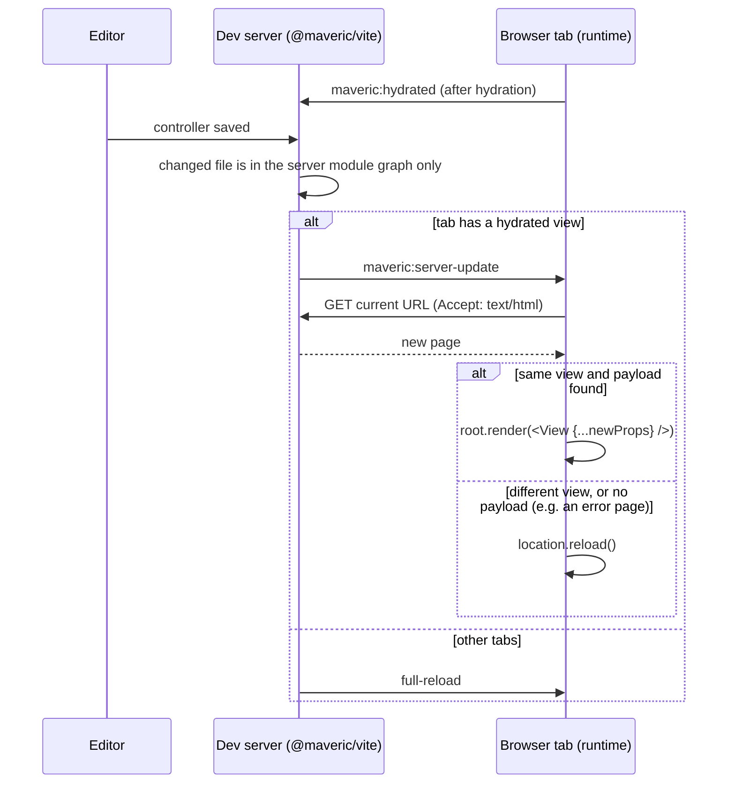

# Hot reloading

During development, changes are applied to open pages without losing their state wherever possible. Changes of browser code are handled by React Fast Refresh; changes of server code, which can't be replaced in the browser, re-render the page with fresh props from the server. Everything else falls back to a full page reload.

## What happens on a change

| Changed module | Result in the browser |
|---|---|
| A view, the layout or another component | Fast Refresh: the component is replaced, its state is kept |
| A non-component module imported by components (helpers, constants) | Fast Refresh of the importing components |
| A module that exports components together with objects or functions | full reload |
| A stylesheet, or an import of one added or removed | the styles are updated in place (see [below](#stylesheets)) |
| A CSS Module | Fast Refresh of the components importing it, whose class names may change, and its styles are updated in place |
| A module used only on the server (controller, schema, middleware, configuration) | props refresh in pages with a hydrated view; full reload in other pages |
| The runtime or other modules imported only by it | full reload |
| A view file added or removed | the client manifest is regenerated |
| `vite.config.ts` | the dev server restarts |

The server always picks up changes immediately: Vite invalidates the changed module and its importers, and the next request runs the new code.

## Fast Refresh

`@vitejs/plugin-react` provides Fast Refresh. Its setup script, which must run before any component module, is part of the development scripts the rendering middleware injects into `<head>` (see [Server-side rendering and hydration](rendering.md#where-it-comes-from)).

### Requirements for views

Fast Refresh replaces a module in place only if its exports are components (or values that don't change), and registers components by analyzing the code. Views created with `view()` meet the requirements only if they follow these rules:

1. **The component is the first argument of `view()`.** The Fast Refresh transform treats `const X = something(component)` as a higher-order component and registers `component`, but it only inspects the first argument of the call. That's why `view()` takes no other arguments, such as `import.meta.url`.
2. **The export is recognizable as a component.** Fast Refresh treats a function as a component if its `name` or `displayName` starts with a capital letter. The component passed to `view()` is an anonymous arrow function, so the `maveric` plugin appends `StatusView.displayName ??= "StatusView"` to every view module, using the file name. For that, the default export must be a variable, either `export default StatusView` or `export { StatusView as default }`; otherwise the plugin logs a warning and Fast Refresh falls back to full reloads. The display name is set in production builds too, where it helps React DevTools.
3. **The module exports only the view.** Fast Refresh accepts other exports only if their values stay identical after the update (constant primitives do; objects and functions are recreated), otherwise it falls back to a full reload.

### Effects and Fast Refresh

Fast Refresh keeps the state of components (`useState`, `useRef`), but runs all their effects again, and recomputes `useMemo` and `useCallback`. Effects must therefore not derive values that should survive an update. `StatusView` keeps the last value from the server and the time it arrived in state, and its effect only ticks the clock:

```tsx
const [lastUpdate, setLastUpdate] = useState(() => ({ uptime, receivedAt: Date.now() }))
if (lastUpdate.uptime !== uptime) {
  setLastUpdate({ uptime, receivedAt: Date.now() })
}

const [now, setNow] = useState(lastUpdate.receivedAt)
useEffect(() => {
  const interval = setInterval(() => setNow(Date.now()), 1000)
  return () => clearInterval(interval)
}, [])
```

The same pattern also makes the view follow new props, whether they come from a props refresh or, later, from polling the server.

## Stylesheets

Vite updates stylesheets in the browser on its own: the module of a stylesheet replaces the content of its `<style>` element when the file changes, and removes the element when no module imports the stylesheet anymore. The stylesheets the server renders into the page (see [Server-side rendering and hydration](rendering.md#stylesheets-during-development)) take part in this, because Vite's client adopts them as its own elements.

When a hot update adds the import of a stylesheet, Vite inserts it at the end of `<head>`, so until the next reload, it may follow stylesheets it precedes in import order.

## Props refresh

Server-side modules can't be replaced in the browser, but a change in a controller or schema typically just changes the data a page shows. Since every page URL also serves its data, the page can fetch it again and re-render, keeping the state of its components.



- **The plugin tracks the connected tabs.** It listens to Vite's `vite:client:connect` and `vite:client:disconnect` events, and to `maveric:hydrated`, which the runtime sends after hydrating a view. The event names are defined in `@maveric/client` as `HMR_EVENTS`.
- **Server-only changes are detected in the `hotUpdate` hook.** When a changed file is part of the server module graph but not of the browser's one, the plugin sends `maveric:server-update` to tabs with a hydrated view, and a full reload to all others.
- **The runtime fetches the page as HTML, not JSON.** The HTML contains the payload with the view's URL, so the runtime can tell whether a different view would render now, and it works for any route and status. If the view differs, or the page has no payload, it reloads instead.
- **Tabs without a hydrated view are reloaded.** That's what makes recovery from errors work: after a broken edit, the tab's refresh fails and it reloads into Vite's error page; that page has no hydrated view, so fixing the file reloads it again, back to the working page.
- **New props don't reset state.** A component whose state was initialized from props keeps that state after a props refresh, unless it syncs with the props, like `StatusView`.

## Replaced mechanisms

The two libraries used before don't work with hydrated pages in Vite 8:

- **`@hono/vite-dev-server`** reloads the page only if a changed module has `ssrModule` set, which Vite 8 clears before calling the hooks, so it never reloads.
- **`vite-ssr-components`** re-renders the page by patching the DOM in place, which breaks a tree hydrated by React; its full-reload mode suppresses Vite's own hot updates, including Fast Refresh. It also only considers files below the Vite root.

## Troubleshooting

- **The page reloads instead of refreshing.** The changed module isn't accepted by Fast Refresh: check that it only exports components, and look for the plugin's display name warning in the dev server output.
- **Changes in `@maveric/vite` have no effect.** The dev server loads the plugin from its build; restart `pnpm dev`, which rebuilds it.
- **Dependencies get optimized on the first page load.** That's expected for dependencies only the runtime imports (`react-dom/client`); it happens once, without a reload.
