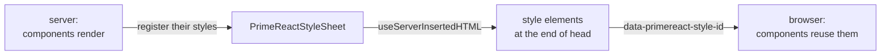

# PrimeReact

The UI components of `@app/ui` come from [PrimeReact](https://primereact.org) 10, in its styled mode with the Lara theme. This document describes how PrimeReact is integrated and imported, and how a patch makes the styles of its components part of the server-rendered page, including the limits of that patch.

## Why version 10

PrimeReact 10 is the last version released under the MIT license, and it's in maintenance mode, getting only security fixes. Version 11 is released under the proprietary PrimeUI License: a free community tier with eligibility limits, a license key, and no extracting of its source code. The project stays on version 10. Should it stop being maintained, or should the [patch](#the-patch) grow too far apart from it, a fork of version 10 based on the patch is an option (see [Roadmap](roadmap.md#planned)).

## Integration

- `@app/ui` depends on `primereact`.
- The entry stylesheet, `src/style/main.css`, imports the theme (`primereact/resources/themes/lara-light-cyan/theme.css`) and orders its cascade layer between Tailwind's preflight and utilities; its name selects the mode and the accent color (see [Styling](styling.md#theme)).
- `App.tsx` imports the entry stylesheet, wraps the document in `PrimeReactProvider`, and passes it the style sheet collecting the component styles on the server (see [below](#wiring)).
- The theme is part of an ordinary imported stylesheet: during development, the dev server renders it into the page; in production, the page links it from the client manifest (see [Server-side rendering and hydration](rendering.md#stylesheets-during-development)).
- The structural styles of the components aren't part of the theme. `primereact/resources/primereact.min.css`, which contained them in earlier versions, is an empty, deprecated file since version 10; the components carry their styles themselves (see [below](#server-rendered-component-styles)).

## Imports

PrimeReact has no `exports` map in its `package.json`. Each module is a directory with its own `package.json` and several builds:

| File | Format | Used by |
|---|---|---|
| `inplace.esm.js` | ES module (`module` field) | bundlers: the dev server's browser modules, the browser bundle, the production server bundle |
| `inplace.cjs.js` | CommonJS (`main` field) | Node.js: the dev server renders pages with it, because Vite leaves PrimeReact to Node.js |
| `inplace.js`, `*.min.js` | scripts for a `<script>` tag | nothing; they expect a global `React` |

- **Import the module directory:** `import { Inplace } from 'primereact/inplace'`. An import of a file picks the same build in every environment; `primereact/inplace/inplace.js` fails with *React is not defined*.
- **Don't import the package root** (`'primereact'`): it's a separate, prebuilt bundle of all modules, which the patch doesn't cover.
- TypeScript 7 auto-imports suggest file imports. The local ESLint rule `prefer-package-directory-imports` reports both kinds of imports and fixes the file imports, on save in WebStorm (see [Tooling](tooling.md#eslint)).

## Server-rendered component styles

### The problem

In styled mode, PrimeReact keeps the structural CSS of its components in JavaScript: a `base` and a `common` style shared by all components, and a style per component (`inplace`, `datatable`, …). Each component inserts them into `<head>` as `<style data-primereact-style-id="…">` elements, from a mount effect. Effects don't run on the server, so a server-rendered page lacks these styles until it's hydrated, in development and in production alike: a Dropdown shows its hidden native `<select>` and text input, a DataTable isn't full width, and so on. The upstream issue ([#5188](https://github.com/primefaces/primereact/issues/5188)) has been open since 2023.

Before inserting a style, a component looks for an existing element with the same `data-primereact-style-id` and reuses it. A page sent with these elements therefore needs no change in the browser.

### The patch

`patches/primereact.patch`, registered in `pnpm-workspace.yaml`, makes the components register their styles while they render on the server:

| Module | Change |
|---|---|
| `hooks` (`useStyle`) | on the server, loading a style registers it with the style sheet from the PrimeReact context, instead of doing nothing; styles that load in an effect are registered while rendering |
| `componentbase` (`useHandleStyle`) | on the server, the base, global, common and component styles are registered while rendering, under the same conditions as in the mount effect (unstyled mode, the `styled` flag) |
| `api` | the `PrimeReactStyleSheet` class, which collects the styles and prints them as `<style data-primereact-style-id>` elements; the `styleSheet` option of `PrimeReactProvider`; their type declarations |

- Both builds of each module are patched: the ES module build and the CommonJS build (see [Imports](#imports) for which runs where).
- Every change is marked with a `// patched:` comment.
- In the browser, the components behave as before: they insert their styles, and find the server-rendered ones.

### Wiring

`App.tsx` creates a style sheet for every render and returns its elements through `useServerInsertedHTML()` from `@maveric/client`, which injects them at the end of `<head>`, after the stylesheets (see [Server-side rendering and hydration](rendering.md#inserting-html-into-head)):

```tsx
const [styleSheet] = useState(() => new PrimeReactStyleSheet())
useServerInsertedHTML(() => styleSheet.toString())

return (
  <PrimeReactProvider value={{ styleSheet }}>
    …
  </PrimeReactProvider>
)
```



### Limits

The following limits are known and accepted. They are also the starting points for a fork.

- **Per-instance styles aren't covered.** Some features create styles per component instance, keyed by attribute ids generated in the browser after mounting: the breakpoints of Dialog, OverlayPanel and the menus (MegaMenu, TieredMenu, ContextMenu, SplitButton, CascadeSelect), the responsive options of Carousel and Galleria, the breakpoints of OrderList and PickList, and the `stack` layout and column resizing of DataTable. These styles still appear only after hydration. Covering them requires ids that match between the server and the browser, a separate change in each of these components (see [Roadmap](roadmap.md#primereact)).
- **Different order.** The server registers the styles in render order (parents first), the browser inserts them in effect order (children first), so the component styles of a server-rendered page may be in a different order than after a client-side render. Almost all of them are in the `primereact` cascade layer, where the order only matters for conflicting rules of two components; `base` and `virtualscroller` aren't in a layer.
- **The package root and the script builds aren't patched.** Imports of module directories always use the patched builds.
- **A custom `styleContainer`** (for example a shadow root) isn't supported: the components look for their styles in the container, not in `<head>`, and insert duplicates of the server-rendered ones.
- **Callbacks registered twice.** `useServerInsertedHTML()` registers its callback on every call, so a component rendering twice within one server render (a state update during rendering) would print the styles twice. `App` doesn't.

## Maintaining the patch

- **Change the patch through pnpm:** `pnpm patch primereact` extracts an editable copy of the package, `pnpm patch-commit <directory>` turns the changes into the patch and reinstalls. Changes made directly in `node_modules` are lost with the next installation.
- **A patch that no longer applies fails the installation.** pnpm applies the patch to whatever version is installed (it's registered without a version); when an update changes the patched code, installing fails with *error applying hunk*, instead of silently dropping the change.
- **Updates are unlikely to break it:** version 10 only gets security fixes, and the patched modules are the stable core of the library.

## See also

- [Server-side rendering and hydration](rendering.md)
- [Styling](styling.md)
- [Tooling](tooling.md#eslint)
- [`@app/ui`](../packages/ui/README.md)
