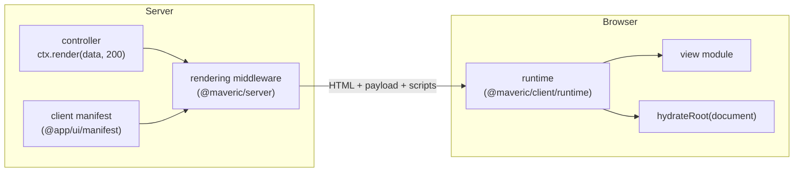

# Server-side rendering and hydration

Every route that defines a view for a status code can answer with an HTML page instead of JSON. The page is rendered by React on the server and hydrated in the browser. This document describes all parts of the mechanism: views, the rendering middleware, the client manifest and the browser runtime.



## Views

### Defining a view

A view is a React component created with `view()` from `@maveric/client`. Its type parameter is the response schema, which types its props:

```tsx
const StatusView = view<typeof statusResponses.getStatus>(({ uptime }) => (
  <App title="Status">
    <div>
      <strong>Uptime:</strong> {uptime} milliseconds
    </div>
  </App>
))

export default StatusView
```

- `view()` returns the component unchanged; it only types it.
- Views must be synchronous components: they are rendered by the synchronous `renderToString`, so async components aren't allowed by the type.
- The component must be the first argument of `view()`, and the view must be the module's only export, a variable exported as default. Both are required by Fast Refresh (see [Hot reloading](hot-reload.md#fast-refresh)).

### Views render the whole document

Every view wraps its content in the `App` layout from `@app/ui`, which renders `<html>`, `<head>` and `<body>`. The page title is passed to `App` as a prop; other head content can be rendered by `App` or by the view itself, since React 19 moves `<title>`, `<meta>` and `<link>` elements into `<head>`. A view may also use a different layout. The reasoning behind this structure is in [Architecture](architecture.md#views-render-the-whole-document).

### Assigning views to routes

A route defines a view per response status, next to the response schema:

```ts
new Controller()
  .endpoint(route({
    method: 'get',
    path: '',
    responses: {
      200: {
        schema: statusResponses.getStatus,
        view: StatusView,
      },
    },
  }), async ctx => ctx.render({ uptime: Date.now() - startTime }, 200))
```

`Controller.endpoint()` registers the route with its OpenAPI definition and attaches the views to the route handler. The handler responds with `ctx.render(data, status)`, which always requires the status.

### Rules for views

- **Browser-safe imports.** Views and everything they import run in the browser too. Type-only imports (such as the response schema) are fine; server-only modules, such as `@app/utils/config`, aren't.
- **Deterministic rendering.** The browser must render exactly the same markup as the server. Values that differ between the two, such as `Date.now()`, `Math.random()` or locale-dependent formatting, must not affect the first render; compute them in state initializers or effects, as `StatusView` does.
- **Props are JSON.** Views receive the response data in its JSON form (see [below](#rendering-middleware)), so a `Date` becomes a string, for example.

## Rendering middleware

`rendering({ manifest })` from `@maveric/server` is a Hono middleware that sets the renderer used by `ctx.render()`. The application registers it with the client manifest:

```ts
import manifest from '@app/ui/manifest'

new OpenAPIHono()
  .use(rendering({ manifest }))
```

For every `ctx.render(object, status, headers?)`, the renderer:

1. **Negotiates the representation** from the `Accept` header. Unless HTML is preferred, it responds with JSON.
2. **Finds the views of the route** on the handler of the last matched route. Hono wraps route handlers when an application with its own error handler is mounted into another one (`app.route()`), and keeps the original handler under a `COMPOSED_HANDLER` key; the middleware follows these wrappers. The production server mounts the API this way.
3. **Picks the view for the status** passed to `ctx.render()`. The status set by `ctx.status()` can't be read by middleware, and `ctx.res.status` is always 200 at this point, hence the required `status` argument.
4. **Falls back to JSON** when the route has no views, or none for the status.
5. **Round-trips the props through JSON**, so that the server renders the view with exactly the props the browser will get for hydration.
6. **Renders the view** with `renderToString` and prepends `<!DOCTYPE html>`. Components can register HTML for `<head>` while rendering (see [below](#inserting-html-into-head)).
7. **Looks up the view in the client manifest.** A view that isn't listed (its file doesn't match the `views` pattern of the Vite plugin) is rendered without hydration, and the middleware logs a warning.
8. **Injects the client code**:
   - at the end of `<head>`: the development scripts from the manifest, the view's stylesheets (as `<style>` elements during development, see [below](#stylesheets-during-development), as links in production), `modulepreload` links, and the HTML registered by components;
   - at the end of `<body>`: the hydration payload, the runtime's module script and the manifest's body content.

During development, `ctx.render()` returns a promise of the response, because the stylesheets are loaded asynchronously; in production, it returns the response itself. Handlers return it either way. Hono's own `c.render()` is typed the same way.

The client code is injected outside of the tree rendered by React. During hydration, React 19 skips nodes it didn't render directly inside `<html>`, `<head>` and `<body>`, and ignores extra nodes after its own. The code goes at the very end, after React's nodes, so that React never mistakes an injected tag for one of its own elements of the same type.

The payload is JSON in a `<script type="application/json">` element, so it isn't executed and doesn't require inline JavaScript. Every `<` in it is escaped as `<`, so that the data can't close the `<script>` element.

## Inserting HTML into `<head>`

Some libraries insert elements into `<head>` in the browser, such as the styles of their components. With `useServerInsertedHTML()` from `@maveric/client`, they can collect them while rendering on the server, and send them with the page:

```tsx
const [styleSheet] = useState(() => new PrimeReactStyleSheet())
useServerInsertedHTML(() => styleSheet.toString())
```

- **The callback runs after rendering**, once all components have registered what they collected. Its HTML goes to the end of `<head>`, after the stylesheets, where libraries insert their elements in the browser.
- **Every call registers the callback**, like Next.js' hook of the same name. A component rendering twice within one server render registers it twice.
- **In the browser, the hook does nothing.**
- **The callbacks are collected in a module-level registry**, which is enough, because views are rendered synchronously, one at a time. The renderer collects them with `renderWithInsertedHTML()` from `@maveric/client`.
- The HTML is also inserted into pages whose view can't be hydrated.

The project uses it for the styles of PrimeReact components (see [PrimeReact](primereact.md#server-rendered-component-styles)).

## Client manifest

The manifest tells the server which client-side files belong to which view:

```ts
interface ClientEntry {
  url: string        // the module
  preload: string[]  // modules to preload with it: the entry itself and the chunks it imports
  css: string[]      // its stylesheets
}

interface ClientManifest {
  runtime: ClientEntry
  views: Map<unknown, ClientEntry>  // keyed by the view components
  head: string                      // HTML for the end of <head>
  body: string                      // HTML for the end of <body>
  styles?(entry: ClientEntry): Promise<string>  // the view's stylesheets as HTML, during development
}
```

Both types are defined in `@maveric/client`, the contract shared by the server and the Vite plugin.

### Where it comes from

The `maveric()` plugin from `@maveric/vite` generates the manifest as the virtual module `virtual:maveric/manifest`. The plugin lists the views by its `views` glob pattern and imports every view module, so that the map can be keyed by the components.

The application doesn't import the virtual module directly: `@app/ui` re-exports it from `src/manifest.ts` as `@app/ui/manifest`, typed as `ClientManifest`. That keeps the virtual module out of `@app/ui`'s type declarations, so packages consuming it don't need its ambient declaration (`@maveric/vite/manifest`, referenced in `packages/ui/src/env.d.ts`).

| | Development | Production |
|---|---|---|
| Generated by | the dev server, on demand | `@app/ui`'s `ssr` build, from its `client` build |
| `url` | source module URL (`/packages/ui/src/view/StatusView.tsx`) | hashed chunk URL (`/assets/StatusView-[hash].js`) |
| `preload` | empty | the entry and all chunks it imports, recursively |
| `css` | empty | the stylesheets of the entry and all chunks it imports, those of the imported chunks first |
| `head`, `body` | the scripts Vite and its plugins inject into pages (Vite client, React Refresh setup) | empty |
| `styles` | the view's stylesheets as `<style>` elements (see [below](#stylesheets-during-development)) | absent |

- **No preloads in development**, because Vite adds `?import` to the URLs of dynamically imported modules, so a preloaded URL would never match the actual request, and the module would be fetched twice.
- **Stylesheets are ordered like Vite orders them in HTML pages:** those of the imported chunks first, then the chunk's own, so that the rules of a view override those of the layout and libraries it imports. The order is per chunk: a view importing its own stylesheet before a component from a shared chunk still gets the shared chunk's stylesheet first.
- **The development scripts** are collected by running Vite's `transformIndexHtml()` on an empty document, so every plugin that injects something into pages (now or in the future) works without hand-written snippets.
- **The manifest is regenerated** when a view file is added or removed during development (implemented, but not exercised yet).

### Stylesheets during development

During development, Vite applies stylesheets by injecting `<style>` elements once the JavaScript importing them runs, so a server-rendered page would be unstyled until then. The `styles()` member of the development manifest renders the view's stylesheets into the page instead:

- **Which stylesheets.** After the view has been rendered, the server module graph contains all modules it imports. The plugin walks the graph from the view module, in import order, and collects the stylesheets, from the project and from packages (such as the PrimeReact theme) alike. It doesn't descend into the imports of a stylesheet (`@import`, the sources Tailwind scans), which are part of it, and skips stylesheets imported as URLs or strings (`?url`, `?inline`, `?raw`).
- **How.** Each stylesheet becomes a `<style data-vite-dev-id="…">` element, identified by the resolved file path and containing the processed CSS, which the plugin loads as `?inline` on the server. Vite's client adopts an element with the id of a stylesheet instead of injecting its own copy: there are no duplicates, hot updates replace the content of the element, and removing the import removes it (see [Hot reloading](hot-reload.md#stylesheets)).
- **The connection to the plugin.** The manifest module runs in Vite's module runner, while the plugin runs in Node.js itself, in the same process; `styles()` calls the plugin through a global (`Symbol.for('maveric:dev-styles')`).
- **When it can't.** If the `ssr` environment can't run modules, or the view isn't in its module graph, the page is rendered without stylesheets and the plugin logs a warning. The plugin recognizes a runnable environment by its `runner`, not by its class (Vite's `isRunnableDevEnvironment()`), because it may get another copy of Vite than the dev server (see [Workspace packages](workspace-packages.md#pnpm-specifics)).

Rejected alternatives:

- **Links** (`<link rel="stylesheet" data-vite-dev-id>`), which Vite's client adopts as well. The browser requests a linked stylesheet as `?direct`, which adds another module for the file to the browser module graph. For a CSS Module, that module can't accept updates and has no importers, so every change of a CSS Module would reload all open pages. Loading the content on the browser side (`?inline`, `?direct`) has the same effect, that's why the content is loaded on the server.
- **Removing the server-rendered styles after hydration**, leaving the updates to Vite's own elements: the styles would be duplicated until then, and the runtime would need code to remove them.

Costs and caveats:

- Pages are larger during development, by the size of their stylesheets (over 200 kB with the PrimeReact theme).
- Adopting an element, Vite's client rewrites its content, so fonts the stylesheet references are requested again. In Chrome 154 and later, text with `font-display: optional` fonts may stay in the fallback font ([Vite issue #23696](https://github.com/vitejs/vite/issues/23696), fixed after Vite 8.3.3).
- The module graph doesn't distinguish static and dynamic imports, so the stylesheets of dynamically imported modules are rendered too (not tested yet).

### Keyed by components

Because the manifest maps view *components* to their entries, the manifest module must import the very same module instances as the server code that renders the views:

- In development, both import the same source files.
- In production, the manifest is generated inside `@app/ui`'s `ssr` build, where it imports `./view/StatusView.js`, the same file that `@app/ui/view/StatusView` points to. The server bundle therefore contains one instance of each view.

That's the main reason `@app/ui` is built by Vite instead of `tsc`: the manifest can only be generated where the client build happens, and it must reference the same modules the server imports. The other reason is that views importing stylesheets or images can't be compiled by `tsc` alone.

## Browser runtime

`@maveric/client/runtime` is the browser entry point, loaded by the module script the middleware injects. It:

1. reads the payload, `{ view, props }`, from the `<script id="__maveric">` element;
2. imports the view module from the payload's URL;
3. hydrates the whole document: `hydrateRoot(document, createElement(View, props))`.

- Module scripts are deferred, so the runtime runs after the whole document is parsed.
- The Vite plugin resolves the runtime from one of the views, so it always comes from the same `@maveric/client` package the views use. In production, it is the `runtime` chunk of the browser bundle.
- During development, the runtime also handles the props refresh (see [Hot reloading](hot-reload.md#props-refresh)).

## Hydration consistency

- **Same props.** Rendering from the JSON form of the props guarantees that both sides render the same data.
- **Same tree.** The server and the browser both render the whole document from the same root, so identifiers generated by `useId`, which depend on the position in the tree, match.
- **Browser extensions.** Extensions that add nodes to `<head>` or `<body>` don't cause problems. Extensions that add attributes to `<html>` or `<body>` (for example, Dark Reader adds `data-darkreader-*`) make React log *"A tree hydrated but some attributes of the server rendered HTML didn't match"*. This warning exists only in React's development build; React leaves the attributes as they are, and hydration works. The warnings are intentionally **not** suppressed with `suppressHydrationWarning`: it would silence every attribute mismatch on these elements, including genuine ones (`lang`, `dir`, a theme class), which are valuable clues when troubleshooting. Disable such extensions for `localhost` instead.

## Security

- **No source paths reach the browser.** The payload contains only the hashed URL of the view chunk. Vite's manifest, which maps source files to built ones, is removed from the browser bundle; the server gets the information it needs as part of its build. The browser bundle is minified and has no source maps.
- **Chunk names keep the module names** (`StatusView-[hash].js`). This is deliberate: it reveals no more than the component names, and helps when troubleshooting in the browser.
- **The payload is escaped**, see [above](#rendering-middleware).

## Limitations

- One view per response; views render synchronously with `renderToString` (no streaming, no async components).
- The view is chosen by the status passed to `ctx.render()`; a status set only by `ctx.status()` isn't taken into account.
- Missing views fall back to JSON silently (see the TODOs in the middleware).

See also [Roadmap](roadmap.md).
