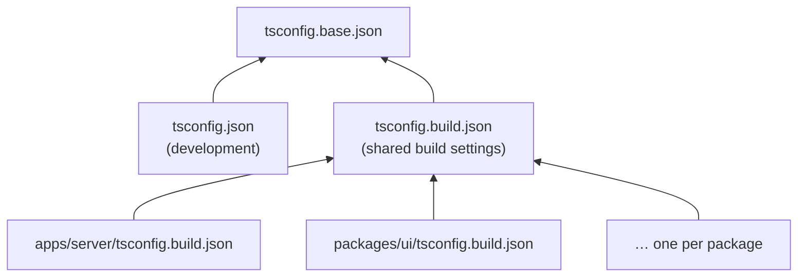

# TypeScript configuration

The project distinguishes two contexts (see [Architecture](architecture.md#development-and-production-contexts)): during **development**, the whole project is a single TypeScript program; for **production**, every package is compiled on its own. Each context has its own configuration file, and both share a common base.

## Files

| File | Purpose | Used by |
|---|---|---|
| `tsconfig.base.json` | Compiler options shared by all configurations | the two files below |
| `tsconfig.json` | Development context: the whole project as one program | editors, ESLint, `pnpm typecheck` |
| `tsconfig.build.json` | Settings shared by all package builds | the package build configs |
| `<package>/tsconfig.build.json` | Build of one package | the package's `build` script, its Vite config |



There are deliberately **no package-level `tsconfig.json` files** (see [below](#why-there-are-no-package-level-tsconfigjson-files)).

## `tsconfig.base.json`

Only the compiler options that both contexts must agree on:

- **`target: ESNext`** — the code is compiled for current runtimes; Vite takes care of browser compatibility of the client bundle.
- **`module: NodeNext`** — packages are ES modules (`"type": "module"`), so relative imports need explicit `.js` extensions, even when importing `.ts` or `.tsx` files (`import App from '../App.js'`).
- **`strict: true`**.
- **`verbatimModuleSyntax: true`** — imports used only as types must be written as `import type`, so that every compiler (TypeScript, Oxc in Vite) can remove them without type information.
- **`skipLibCheck: true`**.
- **`jsx: react-jsx`** — the automatic JSX runtime; components don't import React.

## `tsconfig.json` — the development context

The root configuration covers the whole project as a single program, so that editors and linters see all packages at once, and changes propagate between packages immediately.

- **`include`** covers the root-level `.ts` files (`vite.config.ts`), package-level `.ts` files (package Vite configs, `libs/maveric-vite/manifest.d.ts`) and the `src` directories of all packages. A file outside these patterns is neither type-checked nor linted with type information.
- **`noEmit: true`** — the development program is only checked, never compiled. Without it, `tsc -p tsconfig.json` would write `.js` files next to the sources.
- **`customConditions: ["source"]`** — workspace packages resolve to their source files through the `source` condition of their `exports`, instead of their build outputs. See [Workspace packages](workspace-packages.md#the-source-export-condition).
- **`types: ["node", "vite/client"]`** — the ambient types of all environments; see below.

### Ambient types are declared at the root

A single program can have only one set of global declarations, so the development configuration declares the ambient types of both environments: Node.js (`process`, Node.js modules) and Vite's client types (`import.meta.hot`, `import.meta.env`). In the editor, browser code can therefore use Node.js globals without an error, and server code can use `import.meta.hot`.

This is an accepted trade-off: the package build configurations declare exactly the ambient types each package may use, so any misuse is caught by `pnpm build`.

### `types` must be listed explicitly

Since TypeScript 6, `types` defaults to `[]`: global type packages such as `@types/node` aren't loaded unless a configuration lists them. A missing entry shows up as errors like *Cannot find name 'process'* or *Cannot find name 'node:path'*.

Type packages listed in `types` are looked up in `node_modules/@types` next to the configuration file. That's why `@types/node` is a dev dependency of the root package, even though the root has no code using it.

## `tsconfig.build.json` — shared build settings

The settings common to all package builds:

```json
{
  "extends": "./tsconfig.base.json",
  "include": ["${configDir}/src"],
  "compilerOptions": {
    "rootDir": "${configDir}/src",
    "outDir": "${configDir}/dist",
    "declaration": true,
    "declarationMap": true,
    "sourceMap": true
  }
}
```

`${configDir}` (available since TypeScript 5.5) resolves to the directory of the configuration that is actually being compiled, not of the file that defines the setting. Paths set this way therefore point into each package that extends the file, so the package configurations don't need to repeat them.

Limiting `include` to `src` also keeps package-level files, such as `vite.config.ts`, out of the package builds.

## Package build configurations

Each package has a minimal `tsconfig.build.json` that extends the shared one and adds only what is specific to the package:

| Package | Additional settings | Why |
|---|---|---|
| `@maveric/client` | `types: ["vite/client"]` | the runtime uses `import.meta.hot` |
| `@maveric/vite` | `types: ["node"]` | a Vite plugin runs in Node.js |
| `@app/utils` | `types: ["node"]` | reads `process.env` |
| `@app/ui` | `outDir: ./dist/ssr`, `emitDeclarationOnly` | Vite compiles the JavaScript; `tsc` only adds declarations next to it |
| `@app/server` | `types: ["node"]`, `noEmit` | Vite bundles the server; `tsc` only type-checks it |
| others | — | |

Package Vite configurations point Vite to the build configuration with the `tsconfig: 'tsconfig.build.json'` option, so the production transforms use the same settings as the package build. See [Vite setup](vite.md).

## Why there are no package-level `tsconfig.json` files

Editors, ESLint and other tools look for the nearest file named `tsconfig.json`. A package-level `tsconfig.json` extending the root one inherits the root's `include`, which is resolved relative to the root, so it defines a project spanning **the whole repository** with slightly different options. Tools then pick whichever of these overlapping projects is nearest to the file they process.

Such files used to exist, mainly because of the `types` lookup described above: before `@types/node` was installed at the root, files covered only by the root configuration couldn't see Node.js types.

Package-specific settings belong in the package's `tsconfig.build.json`. Settings needed by the development context belong in the root `tsconfig.json`.

## TypeScript versions

Two major versions of TypeScript are used side by side:

- **TypeScript 6** is the root package's `typescript` dependency (`npm:@typescript/typescript6`, binary `tsc6`). ESLint's TypeScript integration needs the JavaScript API of the compiler, which the native TypeScript 7 doesn't provide.
- **TypeScript 7** (the native compiler) is a dev dependency of every package and compiles the package builds (`tsc`).
- **WebStorm** is set to its bundled TypeScript-Go 7 language service; errors shown in the editor come from it.

All configurations must work with both versions. Both support `${configDir}` and `customConditions` together with `module: NodeNext`.

## Type checking

- **`pnpm typecheck`** checks the development program, i.e. the whole project, with TypeScript 6.
- **The same check with TypeScript 7**: `pnpm --filter @app/ui exec tsc -p ../../tsconfig.json` (any package with TypeScript 7 installed will do).
- **`pnpm build`** type-checks every package on its own, with exactly its own ambient types, as part of the package builds.

## Pitfalls

- **Path mappings with several extension-specific fallbacks** (e.g. `["./src/*.tsx", "./src/*.ts"]`) make TypeScript 6 crash with *Debug Failure*. The project doesn't use `paths` anymore; if they are ever reintroduced, map without extensions (`./src/*`).
- **Files outside the `include` patterns** of the root configuration aren't part of the development program, so the editor and ESLint treat them as files without a project.
