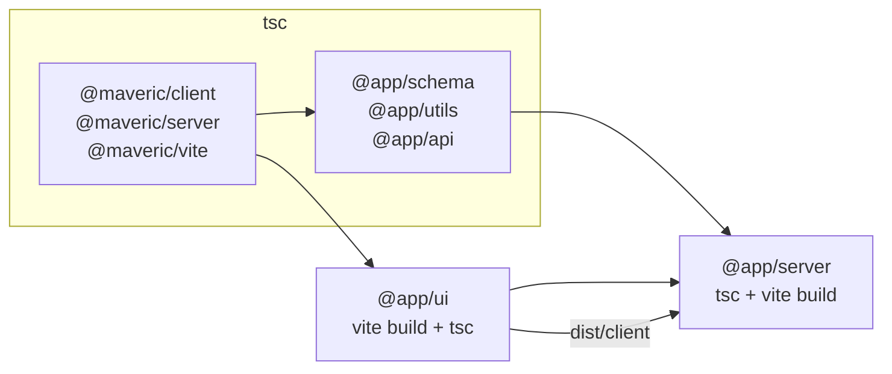

# Vite setup

The project uses [Vite 8](https://vite.dev), which compiles code with [Oxc](https://oxc.rs) and bundles it with [Rolldown](https://rolldown.rs). Following the [two contexts](architecture.md#development-and-production-contexts), there are three Vite configurations:

| Configuration | Context | Purpose |
|---|---|---|
| `vite.config.ts` (root) | development | one dev server for the whole project |
| `packages/ui/vite.config.ts` | production | the browser bundle and the server-side modules of the UI |
| `apps/server/vite.config.ts` | production | the self-contained server bundle |

All other packages are compiled by `tsc` (see [Workspace packages](workspace-packages.md#package-conventions)).

## Development server

`pnpm dev` starts the dev server with the root configuration, at `http://localhost:5173`. The dev server renders pages on the server and serves the browser modules of all packages from their sources, so a change anywhere in the project is reflected immediately (see [Hot reloading](hot-reload.md)).

### Plugins

- **`developmentOnly`** — a small inline plugin that makes `vite build` fail at the root with a hint to use `pnpm build`. Building the root configuration would bundle the sources of all packages, which is not how the production application is built.
- **`@hono/vite-dev-server`** — runs the Hono application (`packages/api/src/index.ts`) inside the dev server, loading it through Vite's server-side module runner on every request.
  - `injectClientScript: false`: the rendering middleware injects the client scripts itself (see [Server-side rendering and hydration](rendering.md#rendering-middleware)).
  - `exclude`: the plugin's middleware runs *before* Vite serves files, and passes every request to the Hono application unless it matches the `exclude` patterns or a file in the public directory. The default patterns cover URLs like `*.ts`, `*.tsx`, `*.css` or `/@…`, but not, for example, an imported image (`/packages/ui/src/logo.svg?import`), which the Hono application would answer with a 404. The configuration therefore adds `/^\/(?:packages|libs)\//`: all source files of the workspace are served by Vite.
- **`@vitejs/plugin-react`** — React Fast Refresh. Its setup script is injected into pages by the rendering middleware, like the Vite client.
- **`@tailwindcss/vite`** — Tailwind CSS: processes the entry stylesheet of `@app/ui`, generating the utilities its sources use. See [Styling](styling.md).
- **`maveric({ views })`** from `@maveric/vite` — generates the client manifest, injects the development scripts and the views' stylesheets into pages, keeps views recognizable by Fast Refresh and refreshes pages after server-side changes. See [Server-side rendering and hydration](rendering.md#client-manifest) and [Hot reloading](hot-reload.md).

### Resolution

`resolve.conditions` (browser modules) and `ssr.resolve.conditions` (server-side modules) put the `source` condition in front of Vite's default conditions, so workspace packages resolve to their source files. See [Workspace packages](workspace-packages.md#the-source-export-condition).

### Public files

`publicDir` points to `packages/ui/public`. Its files are served at the root URL (`packages/ui/public/favicon.svg` is `/favicon.svg`) and copied into the browser bundle by the production build. Reference them by their URL and don't import them: an import of a file from the public directory gets a URL of its source location, which isn't served in production.

### Loading the plugin

Vite bundles `vite.config.ts` before running it, and leaves all package imports to Node.js. Node.js doesn't know the `source` condition, so it loads `@maveric/vite` from its build output. That's why `pnpm dev` runs `turbo build --filter=@maveric/vite` first: the build is quick and cached when nothing has changed. After changing the plugin, restart the dev server.

### Dependency optimizer

Vite pre-bundles the dependencies of browser modules (React and friends) and discovers them by crawling entry modules. There's no `index.html` to crawl, so the `maveric` plugin sets the view patterns as `optimizeDeps.entries`. `react-dom/client`, which only the runtime imports, is discovered on the first page load without causing a reload.

`@vitejs/plugin-react` asks the optimizer to include `react`, `react-dom` and their JSX runtimes, resolving them from the project root. That's why the root package declares `react` and `react-dom` as dev dependencies; without them, every start logs *Failed to resolve dependency*.

## Production builds

`pnpm build` runs `turbo build`, which builds every package with its own `build` script, in dependency order. Package Vite configurations don't enable the `source` condition, so workspace packages resolve to their build outputs, and they set `tsconfig: 'tsconfig.build.json'` (a Vite 8 option), so that Vite's transforms use the package's build configuration.



### `@app/ui`

`packages/ui/vite.config.ts` builds two [environments](https://vite.dev/guide/api-environment), with the `maveric` and `tailwindcss` plugins:

- **`client`** — the browser bundle, in `dist/client`:
  - the runtime and every view are entries; the runtime is emitted as the `runtime` chunk;
  - it's built for the browsers of the browserslist configuration in the root `package.json` (see [Styling](styling.md#browser-support));
  - React and other dependencies go into a separate `vendor` chunk (Rolldown's `output.codeSplitting` groups), which stays cached as long as the dependencies don't change;
  - the public files are copied into it;
  - file names keep the module names (`StatusView-[hash].js`), which helps when troubleshooting in the browser.
- **`ssr`** — the server-side modules imported by other packages (views, `App`, the manifest), in `dist/ssr`:
  - built like a library: `resolve.external: true` keeps all dependencies external (Vite would otherwise bundle linked workspace packages), and `preserveModules` emits one file per source module, mirroring `src/`;
  - the inputs are `src/manifest.ts` and the views, so that their exports are kept;
  - the generated manifest module lands in `dist/ssr/_virtual/`.

`tsc -p tsconfig.build.json` then emits only the type declarations, into `dist/ssr`, next to the JavaScript files.

```
packages/ui/dist/
├── client/            browser bundle, served as static files
│   ├── assets/        runtime-[hash].js, vendor-[hash].js, StatusView-[hash].js and .css, fonts, …
│   └── favicon.svg    public files
└── ssr/               server-side modules (exports: ./manifest, ./view/*)
    ├── manifest.js    + .d.ts
    ├── App.js         + .d.ts
    ├── view/          StatusView.js + .d.ts, …
    └── _virtual/      the generated client manifest
```

The `maveric` plugin coordinates the two builds:

- it sets `builder: {}`, so that `vite build` builds all environments;
- it sets the `build.target` of the `client` environment from the project's browserslist configuration, unless the configuration sets a target itself;
- its `buildApp` hook builds the `client` environment first and then the others, because the `ssr` build needs the client manifest (when a hook builds an environment itself, Vite doesn't build the remaining ones, so the hook builds them all);
- it captures Vite's manifest of the client build in memory and removes it from the output, because it maps source files to the built ones and doesn't belong to the public files;
- it is `sharedDuringBuild`: Vite resolves the configuration separately for every environment, and only a shared plugin instance keeps the captured manifest between the builds;
- the client views keep their exports (`preserveEntrySignatures: 'exports-only'`), because the runtime imports them dynamically and needs their default export.

Why `@app/ui` is built by Vite at all, rather than `tsc`, is explained in [Server-side rendering and hydration](rendering.md#client-manifest).

### `@app/server`

`apps/server/vite.config.ts` builds a single server-side bundle:

- `build.ssr: 'src/index.ts'` with `outDir: 'dist'`, producing `dist/index.js` and its source map;
- `ssr.noExternal: true` bundles all dependencies, taken from their build outputs, so the bundle runs without `node_modules` (see [Deployment](deployment.md));
- a small inline plugin, `copyClientBuild('@app/ui')`, copies the browser bundle of `@app/ui` to `dist/client` after the bundle is written. It finds the package through `@app/ui/package.json`, which `@app/ui` exports for this purpose.

The server serves `dist/client` as static files (see `apps/server/src/index.ts`). Before bundling, the `build` script type-checks the package with `tsc` (its `tsconfig.build.json` sets `noEmit`).

```
apps/server/dist/
├── index.js         the server, with all its dependencies
├── index.js.map
└── client/          copy of @app/ui's dist/client
```

## Vite 8 notes

- Rolldown options go into `build.rolldownOptions` (`rollupOptions` is still accepted). Manual chunking is configured with `output.codeSplitting`; `manualChunks` and `advancedChunks` are deprecated.
- Plugins handle hot updates in the `hotUpdate` hook, which runs once per environment (`this.environment`); `handleHotUpdate` is deprecated.
- Keys of the build manifest are paths of the entry modules relative to the project root; modules outside the root get keys like `../../libs/…`.
- `server.transformIndexHtml()` accepts any HTML string, not only an `index.html` file; the `maveric` plugin uses it on an empty document to collect the scripts Vite and its plugins inject into pages.

## Pitfalls

- **Don't bundle dependencies in the dev server.** `ssr.noExternal: true` belongs to the production server build only. In the dev server, it makes Vite's module runner evaluate React's CommonJS entry as an ES module, which fails with *module is not defined*.
- **A stylesheet module nothing imports reloads all pages.** A `<link>` requests its stylesheet as `?direct`, and a plugin can request one as `?inline` through the browser environment; both add a module for the file to the browser module graph without any importer. For a CSS Module, such a module can't accept updates, so Vite reloads all open pages on every change of the file. That's why the `maveric` plugin loads the stylesheets it renders into pages through the server environment (see [Server-side rendering and hydration](rendering.md#stylesheets-during-development)).
- **Externals resolve to bare specifiers.** In a build that keeps dependencies external, `this.resolve()` returns the package specifier instead of a file path. That's why the `maveric` plugin takes the runtime's file from the client build, which bundles it.
- **Stopping the dev server on Windows** may leave Vite's process running, still holding port 5173; the next dev server then starts on port 5174. Check for leftover `node` processes if the port changes unexpectedly.
