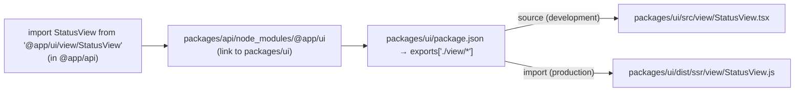

# Workspace packages

The project is a [pnpm](https://pnpm.io) workspace orchestrated by [Turborepo](https://turborepo.com). This document describes the conventions every package follows, how packages resolve each other in development and in production, and how to add a new package.

## Workspace layout

`pnpm-workspace.yaml` includes every directory in `apps/`, `libs/` and `packages/` that contains a `package.json`. A directory without one, such as `libs/maveric` (which only holds the documentation of the Maveric project), isn't a package and is ignored by all tools.

See [Architecture](architecture.md#packages) for the roles of the individual packages and directories.

## Package conventions

- **ES modules.** Every package has `"type": "module"`.
- **Scope.** Application packages use the `@app/` scope, framework packages the `@maveric/` scope.
- **Public interface.** Everything other packages may import is listed in `exports`. Other files can't be imported from outside the package, in development or in production.
- **Two conditions per export.** Each export points to the source file through the `source` condition and to the build output through the `import` condition (see [below](#the-source-export-condition)). Type declarations are emitted next to the JavaScript files, so TypeScript finds them without a separate `types` condition.
- **Declared dependencies.** A package declares every package it imports: runtime imports in `dependencies`, type-only and build-time imports in `devDependencies` (for example, `@app/ui` imports types from `@app/schema` and uses `@maveric/vite` in its build). Framework packages declare `react`, `react-dom`, `hono` or `vite` as peer dependencies, so that the application provides a single copy of each (within the workspace, pnpm may still install several, see [below](#pnpm-specifics)).
- **Build script.** `build` produces `dist/` and starts by cleaning it, so that files of removed sources don't linger:

  | Package type | `build` script |
  |---|---|
  | Library compiled by `tsc` | `rimraf dist && tsc -p tsconfig.build.json` |
  | `@app/ui` | `rimraf dist && vite build && tsc -p tsconfig.build.json` (JavaScript by Vite, declarations by `tsc`) |
  | `@app/server` | `tsc -p tsconfig.build.json && vite build` (type check, then bundle; Vite empties `dist/` itself) |

- **Build configuration.** Each package has a `tsconfig.build.json` extending the root one (see [TypeScript configuration](typescript.md)), and no `tsconfig.json`.

## The `source` export condition

An export with both conditions looks like this:

```json
"exports": {
  "./view/*": {
    "source": "./src/view/*.tsx",
    "import": "./dist/ssr/view/*.js"
  }
}
```

Conditions are matched in the order they are listed, so `source` comes first. Wildcards may include a suffix: `@app/schema` maps `./requests/*` to `./src/requests/*.requests.ts`.

### Who enables the condition

| Tool | Configuration | Resolves to |
|---|---|---|
| TypeScript (editor, ESLint, `pnpm typecheck`) | `customConditions: ["source"]` in the root `tsconfig.json` | source files |
| Vite dev server | `resolve.conditions` and `ssr.resolve.conditions` in the root `vite.config.ts`, i.e. `source` followed by Vite's default conditions | source files |
| Package builds (`tsc`, package Vite configs) | nothing | build outputs |
| Node.js | nothing | build outputs |

Workspace packages are linked into `node_modules` by pnpm, so resolution always follows the real package graph; the condition only decides which file of the package is used.



Because Node.js doesn't know the condition, loading the root `vite.config.ts` imports `@maveric/vite` from its build output. That's why `pnpm dev` builds `@maveric/vite` before starting the dev server (see [Vite setup](vite.md#development-server)).

### Why not TypeScript `paths`

The project used to map workspace imports to source files with `paths` in the root `tsconfig.json` (and `resolve.tsconfigPaths` in Vite). The `source` condition replaced them because:

- **Paths duplicate the exports.** Every entry point had to be described twice, in `package.json` and in the root configuration.
- **Paths bypass package boundaries.** A path mapping works for any file, regardless of whether its package declares the dependency, and a wildcard mapping such as `@app/ui/*` reaches every file in `src`. Such an import works in development and fails only in the production build. With the `source` condition, it fails in development too: for example, `@app/ui` importing `@app/api` (which it doesn't depend on) results in *Cannot find module '@app/api'*.
- **Paths trigger a TypeScript 6 bug** when a mapping lists several extension-specific fallbacks (see [TypeScript configuration](typescript.md#pitfalls)).

### Publishing

If a package is ever published, its `source` condition points to files that aren't part of the package (`files` only includes `dist`). That's harmless, since no consumer enables the condition, but the condition can also be removed through `publishConfig`.

## pnpm specifics

- **Isolated `node_modules`.** Every package can import only its own dependencies. An undeclared dependency fails to resolve even if another package has it installed.
- **Root binaries.** Package scripts can use the binaries of the root package (pnpm adds the root `node_modules/.bin` to their `PATH`), so shared tools such as `rimraf` and `turbo` are installed once, at the root.
- **Root dev dependencies.** Besides the tooling (ESLint, Turborepo, TypeScript 6, Vite and its plugins), the root package declares a few dependencies for specific reasons:
  - `@types/node`, for the ambient types of the development program (see [TypeScript configuration](typescript.md#types-must-be-listed-explicitly));
  - `react` and `react-dom`, which `@vitejs/plugin-react` asks the dev server's dependency optimizer to pre-bundle, resolving them from the root (see [Vite setup](vite.md#development-server));
  - `@maveric/vite`, imported by the root `vite.config.ts`.
- **Copies per set of peer dependencies.** pnpm installs a package once for every set of peer dependencies it's resolved with, optional ones included. Workspace packages are linked, not installed per consumer, so they resolve their peer dependencies from their own dev dependencies. Vite has several optional peer dependencies (`sass-embedded`, `less`, `stylus`, …): adding one only to `@app/ui` gives the root and `@app/ui` another copy of Vite than `@maveric/vite`. Code comparing classes of the two copies (`instanceof`) fails, which is why `@maveric/vite` checks the shape of objects instead (see [Server-side rendering and hydration](rendering.md#stylesheets-during-development)).
- **Workspace protocol.** Workspace dependencies use `workspace:*`.
- **Patched dependencies.** Some third-party packages are patched through `patchedDependencies` in `pnpm-workspace.yaml`; the patches live in `patches/`. Most adapt ESLint configurations and plugins to the current ESLint (see [Tooling](tooling.md#eslint)); `primereact.patch` renders the styles of PrimeReact components on the server (see [PrimeReact](primereact.md#the-patch)). Patches are created and changed with `pnpm patch <package>` and `pnpm patch-commit <directory>`; a patch that no longer applies fails the installation.

## Turborepo

`turbo.json` defines a single task:

```json
"build": {
  "dependsOn": ["^build"],
  "outputs": ["dist/**"]
}
```

- `pnpm build` runs `turbo build`, which builds all packages in dependency order. Dev dependencies count too, so `@maveric/vite` is built before `@app/ui`, whose build uses it.
- Results are cached: a package whose inputs haven't changed isn't rebuilt, and its `dist/` is restored from the cache. `turbo build --force` bypasses the cache.
- `pnpm dev` runs `turbo build --filter=@maveric/vite` first, which also builds the packages it depends on.

## Adding a package

1. Create the package directory in `apps/` (deployable entry point), `libs/` (framework) or `packages/` (application layer).
2. Add `package.json`:
   - `name` with the right scope, `"type": "module"`, `"private": true` (for application packages);
   - `exports`, with both the `source` and `import` condition for every entry point;
   - a `build` script that cleans `dist/` first;
   - all dependencies, including the workspace packages it imports.
3. Add `tsconfig.build.json` extending `../../tsconfig.build.json`, with the ambient `types` the package needs. If it needs ambient types the root `tsconfig.json` doesn't declare yet, add them there too.
4. Put the code into `src/`. The root `tsconfig.json` covers `src/` and `.ts` files at the package root (such as `vite.config.ts`) automatically.
5. Declare the new package as a dependency of every package that imports it.
6. Run `pnpm install`, then check the result with `pnpm typecheck`, `pnpm lint` and `pnpm build`.
