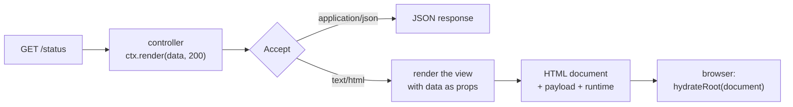

# Maveric

**An MVC-inspired framework for full-stack applications and APIs, built on Hono and React.**

Define a route once, with its data schema, its handler and its view, and get a typed JSON API, an OpenAPI document and a server-rendered page that hydrates in the browser, all from the same definition.

> 🚧 **Status:** early development (0.0.x). The API will change, and the packages aren't published yet. Maveric currently lives in the `libs/` directory of an application template, which also serves as its reference project.

## Why Maveric

Web applications usually describe the same thing several times. There's the API, its documentation, and the pages that show the same data, often fetched again by a separate front-end application. Keeping them in sync is manual work, and they drift apart.

Maveric starts from the API. Every route is defined by three parts, loosely following the Model–View–Controller pattern:

- 📐 **Model** — a [Zod](https://zod.dev) schema describing the data of the response;
- 🎛️ **Controller** — the route handler, which produces the data;
- 🖼️ **View** — a React component rendering the data as a page.

From that single definition, the same URL answers API clients with JSON, documented in the OpenAPI document, and answers browsers with an HTML page. The page is rendered on the server and becomes interactive once hydrated. The view receives exactly the data the API returns, so the page and the API can't diverge.

## Features

- 🎯 **One definition, three outputs:** a JSON API, its OpenAPI description, and a server-rendered page.
- 🔀 **Content negotiation:** the same URL serves JSON or HTML, depending on the `Accept` header.
- 🛡️ **End-to-end types:** the schema types the handler's return value and the view's props.
- 💧 **Server-side rendering with hydration:** views render the whole document, styled from the first paint also during development, and hydrate in the browser with React 19.
- 🔥 **Fast development:** React Fast Refresh for views, and pages that refresh in place with fresh data when server code changes.
- 📦 **Optimized production builds** with Vite 8: hashed chunks, preloading, and a separately cached vendor chunk.
- 🌍 **Runtime-agnostic API:** applications are [Hono](https://hono.dev) applications. Node.js is supported now, edge runtimes are planned.

## A minimal example

A schema, a view and a controller:

```ts
// src/status.schema.ts
import { z } from '@hono/zod-openapi'


const statusSchema = z.object({
  uptime: z.number().describe('Server uptime in milliseconds'),
})

export default statusSchema
```

```tsx
// src/view/StatusView.tsx
import { view } from '@maveric/client'

import type statusSchema from '../status.schema.js'


const StatusView = view<typeof statusSchema>(({ uptime }) => (
  <html lang="en">
    <head>
      <title>Status</title>
    </head>
    <body>
      <strong>Uptime:</strong> {uptime} milliseconds
    </body>
  </html>
))

export default StatusView
```

```ts
// src/app.ts
import { OpenAPIHono } from '@hono/zod-openapi'
import { Controller, rendering, route } from '@maveric/server'
import manifest from 'virtual:maveric/manifest'

import statusSchema from './status.schema.js'
import StatusView from './view/StatusView.js'


const startTime = Date.now()

const statusController = new Controller()
  .endpoint(route({
    method: 'get',
    path: '',
    responses: {
      200: { schema: statusSchema, view: StatusView },
    },
  }), async ctx => ctx.render({ uptime: Date.now() - startTime }, 200))

const app = new OpenAPIHono()
  .use(rendering({ manifest }))
  .route('/status', statusController)

export default app
```

The result:

```sh
curl http://localhost:5173/status
# {"uptime":1234}
```

Opening `http://localhost:5173/status` in a browser shows the rendered `StatusView`, hydrated and ready for interaction.

## How it works



1. **The controller produces data** and calls `ctx.render(data, status)`.
2. **The rendering middleware negotiates the representation.** API clients get JSON. For browsers, the route's view for the status renders the data, and the page receives the data again (as the hydration payload), together with the browser runtime.
3. **The runtime hydrates the page** with the same view and the same data, so the page becomes interactive without rendering anything twice.
4. **The Vite plugin connects the parts:** it tells the server which client-side files belong to which view (the client manifest), builds the browser bundle, and provides hot reloading during development.

The mechanism is described in detail in the [documentation of the reference project](../../docs/rendering.md).

## Packages

| Package | Description |
|---|---|
| [`@maveric/client`](../maveric-client/README.md) | `view()` helper, browser runtime, contracts shared by the server and the browser |
| [`@maveric/server`](../maveric-server/README.md) | `Controller`, `route()` and the rendering middleware |
| [`@maveric/vite`](../maveric-vite/README.md) | Vite plugin: client manifest, browser bundle, hot reloading |

## Built on

- [Hono](https://hono.dev) — the web framework applications are built with
- [`@hono/zod-openapi`](https://github.com/honojs/middleware/tree/main/packages/zod-openapi) and [Zod](https://zod.dev) — typed routes and the OpenAPI document
- [React 19](https://react.dev) — views, server-side rendering and hydration
- [Vite 8](https://vite.dev), with [Rolldown](https://rolldown.rs) and [Oxc](https://oxc.rs) — development server and production builds
- [TypeScript](https://www.typescriptlang.org)

## Getting started

This guide sets up a single-package project, with the files from [the minimal example](#a-minimal-example). For a monorepo setup, see the [reference project](../../README.md).

### 1. Install the dependencies

```sh
pnpm add hono @hono/zod-openapi @hono/node-server zod react react-dom @maveric/client @maveric/server
pnpm add -D vite @vitejs/plugin-react @hono/vite-dev-server @maveric/vite typescript @types/node @types/react @types/react-dom
```

The project must be an ES module package (`"type": "module"` in `package.json`).

### 2. Configure TypeScript

```json
{
  "compilerOptions": {
    "target": "ESNext",
    "module": "NodeNext",
    "strict": true,
    "verbatimModuleSyntax": true,
    "jsx": "react-jsx",
    "types": ["node", "vite/client"],
    "noEmit": true
  },
  "include": ["src", "vite.config.ts"]
}
```

With `module: NodeNext`, relative imports need the `.js` extension, even for `.ts` and `.tsx` files. Add the declaration of the client manifest module:

```ts
// src/env.d.ts
/// <reference types="@maveric/vite/manifest" />
```

### 3. Define the schema, the view and the controller

Create `src/status.schema.ts`, `src/view/StatusView.tsx` and `src/app.ts` from [the minimal example](#a-minimal-example). Keep in mind:

- Views render the whole document; a shared layout component usually renders `<html>`, `<head>` and `<body>`.
- One view per module, in a directory matched by the plugin's `views` pattern, exported as default, as a variable.
- Views run in the browser too: import only browser-safe code, and keep the first render deterministic.

### 4. Configure Vite

```ts
// vite.config.ts
import devServer, { defaultOptions } from '@hono/vite-dev-server'
import react from '@vitejs/plugin-react'
import { maveric } from '@maveric/vite'
import { defineConfig } from 'vite'


export default defineConfig({
  plugins: [
    devServer({
      entry: './src/app.ts',
      injectClientScript: false,
      // the browser loads source modules from the dev server, not from the application
      exclude: [...defaultOptions.exclude, /^\/src\//u],
    }),
    react(),
    maveric({ views: 'src/view/**/*.tsx' }),
  ],
})
```

### 5. Start the development server

```sh
pnpm vite
```

Open `http://localhost:5173/status`. Changes in the view are applied by Fast Refresh; changes in the controller refresh the page with the new data.

### 6. Build for production

Add a server entry, which serves the browser bundle and the application:

```ts
// src/server.ts
import path from 'node:path'
import { serve } from '@hono/node-server'
import { serveStatic } from '@hono/node-server/serve-static'
import { Hono } from 'hono'

import app from './app.js'


const server = new Hono()
  .use(serveStatic({ root: path.join(import.meta.dirname, '../client') }))
  .route('/', app)

serve({ fetch: server.fetch, port: 3000 })
```

Then configure the two environments the plugin builds, the browser bundle (`client`) and the server (`ssr`). The configuration becomes a function, because the server should only be bundled with its dependencies in the build:

```ts
// vite.config.ts
export default defineConfig(({ command }) => ({
  plugins: [/* as above */],
  environments: {
    client: {
      build: { outDir: 'dist/client' },
    },
    ssr: {
      // bundle all dependencies into the server, so it runs without node_modules
      resolve: command === 'build' ? { noExternal: true } : {},
      build: {
        outDir: 'dist/server',
        copyPublicDir: false,
        rolldownOptions: { input: 'src/server.ts' },
      },
    },
  },
}))
```

```sh
pnpm vite build
NODE_ENV=production node dist/server/server.js
```

`vite build` builds the browser bundle first and then the server, which includes the client manifest. Set `NODE_ENV=production` when running the server, so that React uses its production build.

## Status and roadmap

Maveric is in early development. Planned:

- a typed API client generated from the route definitions;
- client-side navigation, using the JSON representation of pages;
- describing views in the OpenAPI document;
- support for edge runtimes such as Cloudflare Workers;
- an overarching `maveric` package for simpler setups.

See the [roadmap of the reference project](../../docs/roadmap.md).

## License

To be decided.
